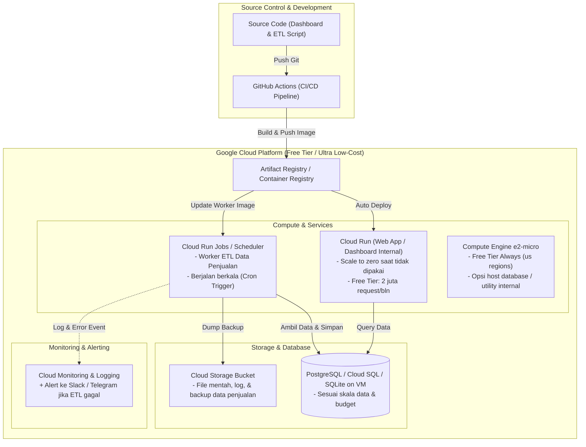
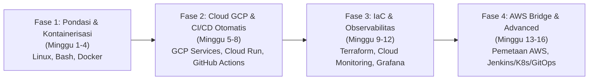

# Roadmap Belajar DevOps Personal: Cloud-Native & Low-Cost Infrastructure

**Target Pengguna:** Data / QA / Support Engineer  
**Studi Kasus / Kebutuhan Riil:** Hosting Dashboard Internal & Otomasi Scheduled ETL Data Penjualan (TBS Food)  
**Alokasi Waktu:** 5–10 Jam / Minggu (Durasi: 14–16 Minggu / ~3.5–4 Bulan)  
**Infrastruktur Target:** Google Cloud Platform (GCP Free Tier & Low-Cost) + Pemetaan Konsep ke AWS  

---

## 1. Arsitektur Target & Strategi Solusi Hemat Biaya

Berikut rancangan target infrastruktur yang akan dibangun untuk mendukung kebutuhan kantor tanpa membengkakkan biaya bulanan:

> [!TIP]
> **Strategi Anggaran Rp 0 - Ringan:**
> - **Cloud Run:** Memiliki gratis 2 juta request/bulan dan fitur *scale-to-zero* (biaya $0 saat tidak ada yang mengakses).
> - **Cloud Run Jobs + Cloud Scheduler:** Sangat ideal untuk script ETL data penjualan. Hanya bayar (dalam hitungan detik) saat script sedang memproses data.
> - **Compute Engine (e2-micro):** GCP menyediakan 1 instance gratis selamanya (*Always Free Tier*) di region US (us-central1, us-east1, us-west1) dengan disk 30 GB.
> - **GitHub Actions:** Gratis 2.000 menit build/bulan untuk private repository.

---

## 2. Struktur Roadmap Pembelajaran (4 Fase)

Berikut pemetaan materi dari `kurikulum.md` yang disaring dan diurutkan agar memberikan hasil instan di pekerjaan kantor terlebih dahulu, disusul pemahaman ekosistem enterprise (AWS & Kubernetes).

---

### Fase 1: Pondasi Sistem, Scripting & Kontainerisasi (Minggu 1 – 4)
*Fokus: Mengemas aplikasi dan script ETL lokal ke dalam container standar produksi.*

* **Target Kompetensi:**
  1. Menguasai perintah Linux sehari-hari untuk administrasi server.
  2. Menulis Bash script untuk mengotomasi tugas data / backup lokal.
  3. Mengemas Dashboard dan Script ETL Data Penjualan ke dalam image Docker yang ramping (*multi-stage build*).
* **Materi dari Kurikulum:**
  - `Linux Fundamentals` & `Server Management in Linux`
  - `Bash Scripting` (Variables, Loops, Conditions, Error handling `set -e`)
  - `Docker` (Containers, Images, Dockerfiles, Volumes, Networks, Multi-container dengan Docker Compose)
* **Milestone / Proyek Riil:**
  - [x] Buat file `Dockerfile` untuk Dashboard internal kantor.
  - [x] Buat file `Dockerfile` untuk script ETL & sample data penjualan.
  - [x] Buat `docker-compose.yml` lokal yang menjalankan dashboard dan database PostgreSQL lokal sekaligus dalam satu perintah `docker compose up`.

---

### Fase 2: Implementasi GCP Hemat Biaya & CI/CD Pipeline (Minggu 5 – 8)
*Fokus: Menyelesaikan kebutuhan kantor di cloud GCP menggunakan GitHub Actions secara otomatis.*

* **Target Kompetensi:**
  1. Navigasi GCP Console & Google Cloud SDK (`gcloud` CLI).
  2. Setup IAM Role & Service Account dengan hak akses minimal (*least privilege*).
  3. Deploy Dashboard ke **Cloud Run** & deploy Worker ETL ke **Cloud Run Jobs** dengan pemicu **Cloud Scheduler**.
  4. Membangun pipeline CI/CD di **GitHub Actions** sehingga setiap kali commit/merge ke branch `main`, aplikasi otomatis ter-build dan ter-deploy tanpa sentuhan manual.
* **Materi dari Kurikulum:**
  - `Google Cloud Platform Project` (Cloud Shell, VPC, Virtual Machines, Cloud SQL, Cloud Storage)
  - `GitHub Actions` (Workflows, Secrets Management, Build & Push Docker image, Automated Deployments)
  - `CI/CD Best Practices`
* **Milestone / Proyek Riil:**
  - [ ] Setup GCP Service Account & Artifact Registry untuk menyimpan container images.
  - [ ] Buat GitHub Actions workflow `.github/workflows/deploy.yml`:
    1. Checkout code & Jalankan unit test/validasi data.
    2. Build Docker image.
    3. Push ke Google Artifact Registry.
    4. Trigger deploy ke GCP Cloud Run & update Cloud Run Job.
  - [ ] Atur cron di Cloud Scheduler (misal: setiap jam 02:00 pagi) untuk menjalankan job ETL penjualan harian.

---

### Fase 3: Infrastructure as Code (IaC) & Observability (Minggu 9 – 12)
*Fokus: Mengontrol seluruh infrastruktur cloud lewat kode (Terraform) dan memasang deteksi error otomatis.*

* **Target Kompetensi:**
  1. Menulis script Terraform untuk membuat resource GCP (Cloud Run, Scheduler, GCS Bucket, Service Account) agar dapat direplikasi kapan saja secara presisi.
  2. Memantau resource CPU/Memory, log aplikasi, dan metriks kustom menggunakan Cloud Logging / Grafana + Prometheus.
  3. Mengonfigurasi notifikasi alert otomatis ke Telegram atau Slack ketika script ETL gagal berjalan (*failed job alert*).
* **Materi dari Kurikulum:**
  - `Terraform Fundamentals` (Variables, State Management, GCP Provider, Modules)
  - `Monitoring & Observability Layer` (CloudWatch/Cloud Monitoring, Prometheus & Grafana konsep, PromQL, Alerting & Notification Strategies)
* **Milestone / Proyek Riil:**
  - [ ] Seluruh resource GCP untuk project TBS Food didefinisikan dalam repository Terraform (`main.tf`, `variables.tf`).
  - [ ] Setup alert policy: Jika error rate Cloud Run > 2% atau Cloud Run Job exit code != 0, kirim pesan instan ke kanal Slack/Telegram tim.

---

### Fase 4: Jembatan Konsep AWS & Eksplorasi Lanjutan (Minggu 13 – 16)
*Fokus: Memanfaatkan materi utama video Udemy (AWS, Kubernetes, ArgoCD) untuk memperluas karir DevOps.*

* **Target Kompetensi:**
  1. Menghubungkan semua pengalaman praktis GCP ke arsitektur AWS (karena 60% materi video kursus menggunakan AWS).
  2. Memahami konsep container orchestration (Kubernetes) secara lokal tanpa mengeluarkan biaya cloud cluster.
  3. Memahami konsep modern GitOps (ArgoCD & Helm).
* **Materi dari Kurikulum:**
  - `AWS Cloud Fundamentals` & `CI/CD on AWS` (EC2, S3, RDS, Lambda, CodePipeline)
  - `Kubernetes Layer` (Pods, Deployments, Services, ConfigMaps, Ingress) menggunakan **Minikube / Kind** di laptop.
  - `Helm & Kubernetes Tooling`
  - `End-to-End GitOps Project` (ArgoCD konsep)
  - `Ansible` (Dasar konfigurasi server)
* **Milestone / Proyek Riil:**
  - [ ] Latihan lab lokal Minikube: Deploy aplikasi multi-tier (frontend, backend, database) menggunakan Helm Chart.
  - [ ] Mengikuti materi AWS di video Udemy dengan pemahaman komparasi GCP:
    - *GCP Compute Engine* $\leftrightarrow$ *AWS EC2*
    - *GCP Cloud Storage* $\leftrightarrow$ *AWS S3*
    - *GCP Cloud Run* $\leftrightarrow$ *AWS App Runner / ECS Fargate*
    - *GCP Cloud Run Jobs / Cloud Functions* $\leftrightarrow$ *AWS Lambda / EventBridge*
    - *GCP Cloud SQL* $\leftrightarrow$ *AWS RDS*

---

## 3. Matriks Komparasi Alat: Kebutuhan Kantor vs Kurikulum Kursus

| Domain | Pilihan Cepat & Efisien Kantor (Fase 1-2) | Materi Lengkap di Kursus Udemy (Fase 4) | Alasan Penyesuaian |
| :--- | :--- | :--- | :--- |
| **Cloud Provider** | **GCP** (Cloud Run, GCE e2-micro, GCS) | **AWS** (EC2, S3, RDS, ALB, Beanstalk) | Kantor memakai GCP kredit $10 & Free Tier; Cloud Run jauh lebih murah daripada AWS ALB + EC2 24/7. |
| **CI/CD** | **GitHub Actions** | **Jenkins** & **GitLab CI** | Jenkins membutuhkan VM yang harus hidup 24/7 (boros credit). GitHub Actions serverless & free quota melimpah. |
| **Penyimpanan Kode** | **GitHub** | **Git / GitHub / GitLab** | Sederhana, terintegrasi langsung dengan Action dan Copilot. |
| **Orchestration** | **Cloud Run** / **Docker Compose** | **Kubernetes (K8s)** + **Helm** + **ArgoCD** | Untuk kebutuhan dashboard internal & batch ETL, K8s terlalu kompleks (*overkill*) dan mahal di awal. Simpan K8s untuk lokal di Fase 4. |
| **Cron / ETL** | **Cloud Run Jobs** + **Cloud Scheduler** | **AWS Lambda** / Cron di EC2 | Cloud Run Jobs mendukung container durasi panjang (hingga 24 jam) dengan environment Python data lengkap. |
| **IaC** | **Terraform (Google Provider)** | **Terraform (AWS Provider)** | Syntax HCL sama, hanya ganti provider block. Keterampilan 100% *transferable*. |

---

## 4. Tips Mengoptimalkan Kredit $10 / Bulan di GCP

> [!IMPORTANT]
> Panduan agar saldo $10 Anda tidak habis sia-sia:
> 1. **Gunakan Cloud Run, Bukan GKE:** Jangan membuat Google Kubernetes Engine (GKE) cluster untuk pekerjaan harian kantor jika budget terbatas; cluster management fee memakan ~$70/bulan jika salah setting.
> 2. **Hindari Cloud SQL 24/7 jika Data Masih Kecil:** Cloud SQL instance terkecil (db-f1-micro) memakan ~$9–$10/bulan. Sebagai alternatif gratis:
>    - Jalankan container PostgreSQL di Compute Engine `e2-micro` (Always Free di region US), ATAU
>    - Gunakan Cloud SQL hanya saat jam kerja dan stop saat malam/weekend menggunakan Cloud Scheduler.
> 3. **Set Budget Alert di GCP Console:** Pasang threshold alert di nominal $5, $8, dan $10 agar ada notifikasi email sebelum saldo terpotong dari kartu kredit pribadi.

