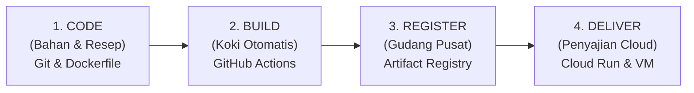

# Framework Mental DevOps: Mengingat Alur Kerja Cloud-Native dengan Mudah

Dokumen ini adalah ringkasan kerangka berpikir (*mental model*) yang bisa Anda bawa ke mana saja, baik dalam pekerjaan sehari-hari di kantor maupun saat interview teknis DevOps.

---

## 1. Kerangka Utama: "Siklus C-B-R-D" (Code, Build, Register, Deliver)

Setiap sistem modern di dunia (apapun bahasanya, apapun cloud-nya) selalu mengikuti 4 langkah berurutan ini:



| Tahapan | Analogi Dapur Katering | Tool yang Anda Pakai | Pertanyaan Kuncinya |
| :--- | :--- | :--- | :--- |
| **1. CODE** | Menulis resep & bumbu | **Git / GitHub** + `Dockerfile` | *"Apakah kodenya sudah diuji dan ada resep pembungkusnya?"* |
| **2. BUILD** | Koki memasak di dapur | **GitHub Actions** / Cloud Build | *"Siapa yang mem-build image secara otomatis tanpa intervensi manusia?"* |
| **3. REGISTER** | Makanan beku masuk gudang logistik | **Google Artifact Registry** | *"Di mana image matang disimpan secara aman dan siap diambil?"* |
| **4. DELIVER** | Pelayan menyajikan ke meja tamu | **Cloud Run** / **Cloud Run Jobs** | *"Di mana aplikasi dijalankan agar hemat biaya dan bisa diakses publik?"* |

---

## 2. Pohon Keputusan: "Ke Mana Aplikasi Saya Harus Ditaruh?"

Sering kali engineer bingung memilih layanan cloud. Cukup gunakan **Pohon Keputusan 3 Detik** ini:

```
                            APLIKASI ANDA
                                  │
          ┌───────────────────────┴───────────────────────┐
          ▼                                               ▼
Apakah butuh simpan data permanen               Apakah aplikasinya TIDAK
ke harddisk lokal?                              menyimpan data di harddisk lokal?
(Contoh: Database PostgreSQL/MySQL)             (Stateless: Web, API, ETL Worker)
          │                                               │
          ▼                                               ▼
   Gunakan VM INSTANCE                            Gunakan CLOUD RUN
  (Compute Engine e2-micro)                               │
                                        ┌─────────────────┴─────────────────┐
                                        ▼                                   ▼
                             Apakah tugasnya melayani            Apakah tugasnya tugas batch
                             pengunjung web lewat URL?           yang jalan berkala lalu mati?
                             (Contoh: Dashboard Penjualan)       (Contoh: ETL Jam 02:00 Pagi)
                                        │                                   │
                                        ▼                                   ▼
                                CLOUD RUN SERVICES                   CLOUD RUN JOBS
                                (Min-instances = 0)                 + CLOUD SCHEDULER (Cron)
```

---

## 3. Rumus Pengingat Tiga Pertanyaan Emas (The 3-W Rules)

Kapan pun Anda diminta membuat sistem baru di kantor, tanyakan 3 hal ini pada diri sendiri:

1. **WHERE is the state? (Di mana datanya tinggal?)**
   * Jika ada data penting $\rightarrow$ Amankan di database terpisah / VM / Storage Bucket.
   * Sisanya buat tanpa data (*stateless*) agar bisa di-restart kapan saja tanpa takut data hilang.
2. **WHEN does it run? (Kapan server ini harus hidup?)**
   * Butuh melayani orang setiap saat $\rightarrow$ **Cloud Run Service** (bisa tidur saat sepi).
   * Hanya butuh hidup jam 2 pagi $\rightarrow$ **Cloud Run Job + Cloud Scheduler**.
3. **WHO deploys it? (Siapa yang bertanggung jawab deploy?)**
   * Jangan manusia! Serahkan pada **GitHub Actions** lewat `git push`. Manusia fokus koding, robot fokus deploy.
