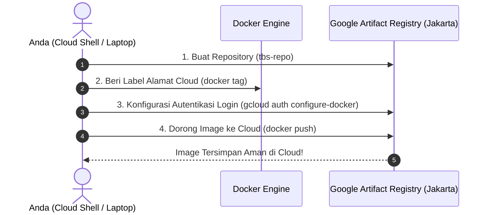

# Modul 2.2: Google Artifact Registry & Image Management di Cloud

Dokumentasi ini adalah bagian dari **Fase 2: Implementasi GCP Hemat Biaya & CI/CD Pipeline** pada [ROADMAP.md](../../ROADMAP.md).

---

## 1. Mengapa Butuh Container Registry di Cloud?

Di Fase 1, Anda berhasil mem-build Docker Image di laptop Anda:
`tbs-sales-app:v1`

Namun ada satu kendala:
* Docker Image tersebut **hanya tersimpan di harddisk laptop Anda**.
* Layanan cloud seperti **GCP Cloud Run** tidak bisa mengakses laptop pribadi Anda untuk mendownload image tersebut saat hendak dijalankan.

Oleh karena itu, kita butuh "Gudang Penyimpanan Docker Image" privat di cloud yang aman dan cepat diakses oleh server Google. Di GCP, layanan ini bernama **Google Artifact Registry**.

---

## 2. Struktur Format Penamaan Image Standar Cloud

Jika di lokal Anda cukup memberi nama pendek seperti `tbs-sales-app:v1`, di cloud nama image harus memiliki alamat lengkap yang unik di seluruh dunia:

```
[REGION]-docker.pkg.dev / [PROJECT-ID] / [NAMA-REPOSITORY] / [NAMA-IMAGE] : [TAG]
```

Contoh riil dengan Project ID Anda (`the-byway-487902-m9`):
```
asia-southeast2-docker.pkg.dev/the-byway-487902-m9/tbs-repo/sales-dashboard:v1
```

* **`asia-southeast2`:** Lokasi data center (Region **Jakarta, Indonesia**), paling dekat dan latensi tercepat.
* **`the-byway-487902-m9`:** Project ID unik GCP Anda.
* **`tbs-repo`:** Nama gudang repository yang akan kita buat.
* **`sales-dashboard`:** Nama aplikasi Anda.
* **`:v1`:** Versi rilis (*tag*).

---

## 3. Alur Kerja Mendorong (*Push*) Image ke Cloud



---

## 4. Langkah Praktik di Google Cloud Shell

Jalankan 4 perintah berikut langsung di terminal **Google Cloud Shell** Anda:

### Langkah 1: Buat Repository Baru di Region Jakarta (`asia-southeast2`)
Ketik perintah ini di Cloud Shell:
```bash
gcloud artifacts repositories create tbs-repo \
    --repository-format=docker \
    --location=asia-southeast2 \
    --description="Repository Docker Image TBS Food"
```

### Langkah 2: Beri Izin Autentikasi Docker ke Artifact Registry
Agar Docker di terminal Anda diizinkan mengirim file ke gudang GCP:
```bash
gcloud auth configure-docker asia-southeast2-docker.pkg.dev
```
*(Jika muncul pertanyaan konfirmasi `Do you want to continue (Y/n)?`, ketik **Y** lalu tekan Enter).*

### Langkah 3: Siapkan Contoh Aplikasi & Build Langsung di Cloud Shell
Di Cloud Shell, buat folder mini dan file aplikasi sederhana untuk kita uji coba push:

```bash
# Buat folder kerja di Cloud Shell
mkdir -p ~/tbs-cloud-app && cd ~/tbs-cloud-app

# Buat file Dockerfile sederhana
cat << 'EOF' > Dockerfile
FROM python:3.11-slim
WORKDIR /app
RUN echo '{"status":"READY_ON_GCP","company":"TBS Food"}' > index.json
CMD ["python", "-m", "http.server", "8080"]
EOF

# Build image dengan alamat lengkap Artifact Registry Anda
docker build -t asia-southeast2-docker.pkg.dev/the-byway-487902-m9/tbs-repo/sales-dashboard:v1 .
```

### Langkah 4: Dorong (*Push*) Image ke Google Artifact Registry
```bash
docker push asia-southeast2-docker.pkg.dev/the-byway-487902-m9/tbs-repo/sales-dashboard:v1
```

---

## 5. Cara Memverifikasi Hasil di GCP Console

Setelah proses `docker push` selesai (ditandai dengan bar progress upload mencapai 100%):
1. Buka browser di [Google Cloud Console](https://console.cloud.google.com/).
2. Di kolom pencarian atas, ketik: **Artifact Registry**.
3. Klik **Repositories** $\rightarrow$ Anda akan melihat repository **`tbs-repo`** di region `asia-southeast2`.
4. Klik ke dalamnya, dan Anda akan melihat paket image **`sales-dashboard`** dengan tag **`v1`** sudah tersimpan rapi di cloud!

