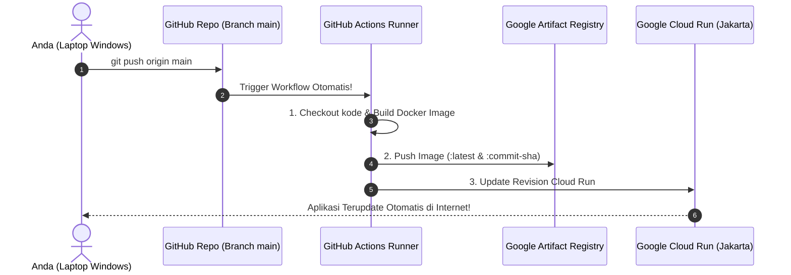

# Modul 2.4: Otomasi CI/CD Pipeline dengan GitHub Actions

Dokumentasi ini adalah bagian penutup dari **Fase 2: Implementasi GCP Hemat Biaya & CI/CD Pipeline** pada [ROADMAP.md](../../ROADMAP.md).

---

## 1. Apa itu CI/CD dan Mengapa Wajib Dimiliki?

Hingga saat ini, proses rilis aplikasi Anda masih bersifat **manual**:
1. Anda mengedit kode di laptop.
2. Anda harus buka Cloud Shell.
3. Anda harus mengetik `docker build` dan `gcloud run deploy`.

Bagaimana jika Anda mengedit kode 10 kali sehari? Mengetik perintah yang sama berulang kali menghabiskan waktu dan rentan salah ketik (*human error*).

**CI/CD (Continuous Integration & Continuous Deployment)** mengubah alur tersebut menjadi **100% otomatis**:
* **Continuous Integration (CI):** Setiap kali Anda mengirim kode baru ke GitHub (`git push`), robot otomatis memvalidasi kode dan mem-build Docker Image.
* **Continuous Deployment (CD):** Begitu image selesai di-build, robot otomatis mengirimnya ke Artifact Registry dan memperbarui service Cloud Run secara instan.



---

## 2. Jembatan Keamanan: GCP Service Account & GitHub Secrets

Agar robot GitHub diizinkan masuk dan mengacak-acak project Google Cloud Anda, GitHub butuh "Kunci Masuk Resmi". 

Kita **TIDAK PERNAH** menaruh password atau kunci rahasia di dalam file kode (karena bisa dicuri orang). Di GitHub, kunci disimpan di brankas terenkripsi bernama **GitHub Actions Secrets**.

---

## 3. Langkah Praktik 1: Membuat Kunci Service Account di GCP

Buka terminal **Google Cloud Shell** Anda dan jalankan perintah di bawah ini (Project ID sudah disesuaikan dengan `the-byway-487902-m9`):

### A. Buat Service Account Baru Bernama `github-deployer`
```bash
gcloud iam service-accounts create github-deployer \
    --description="Service account untuk deploy otomatis dari GitHub Actions" \
    --display-name="GitHub Deployer"
```

### B. Beri Izin (Role) Minimal yang Dibutuhkan
Robot ini butuh 3 izin penting:
1. Izin push image ke Artifact Registry (`roles/artifactregistry.writer`)
2. Izin deploy ke Cloud Run (`roles/run.admin`)
3. Izin bertindak sebagai service user (`roles/iam.serviceAccountUser`)

Jalankan perintah ini:
```bash
PROJECT_ID="the-byway-487902-m9"
SA_EMAIL="github-deployer@${PROJECT_ID}.iam.gserviceaccount.com"

# 1. Izin Artifact Registry
gcloud projects add-iam-policy-binding $PROJECT_ID \
    --member="serviceAccount:$SA_EMAIL" \
    --role="roles/artifactregistry.writer"

# 2. Izin Cloud Run Admin
gcloud projects add-iam-policy-binding $PROJECT_ID \
    --member="serviceAccount:$SA_EMAIL" \
    --role="roles/run.admin"

# 3. Izin Service Account User
gcloud projects add-iam-policy-binding $PROJECT_ID \
    --member="serviceAccount:$SA_EMAIL" \
    --role="roles/iam.serviceAccountUser"
```

### C. Download Kunci Rahasia Berbentuk JSON
```bash
gcloud iam service-accounts keys create ~/gcp-key.json \
    --iam-account=$SA_EMAIL
```

### D. Tampilkan Isi Kunci untuk Dicopy
```bash
cat ~/gcp-key.json
```
Copy seluruh teks yang muncul (dari tanda kurung kurawal `{` sampai `}`).

---

## 4. Langkah Praktik 2: Simpan Kunci di GitHub Repository Secrets

1. Buka browser di repositori GitHub Anda: [https://github.com/ferrysetefanus/belajar-devops](https://github.com/ferrysetefanus/belajar-devops)
2. Klik tab **Settings** (di menu atas).
3. Di panel menu sebelah kiri, klik **Secrets and variables** $\rightarrow$ pilih **Actions**.
4. Klik tombol hijau **New repository secret**:
   * **Name:** `GCP_SA_KEY`
   * **Secret:** Paste seluruh isi JSON yang tadi Anda copy dari Cloud Shell.
   * Klik **Add secret**.
5. Buat satu secret lagi:
   * Klik **New repository secret**.
   * **Name:** `GCP_PROJECT_ID`
   * **Secret:** `the-byway-487902-m9`
   * Klik **Add secret**.

---

## 5. Langkah Praktik 3: File Pipeline `.github/workflows/deploy.yml`

Setelah kedua secret terpasang, kita cukup membuat satu file YAML di proyek kita:  
📁 `.github/workflows/deploy.yml`

File ini akan memberitahu GitHub Actions langkah-langkah yang harus dilakukan setiap kali ada `git push` ke branch `main`.

